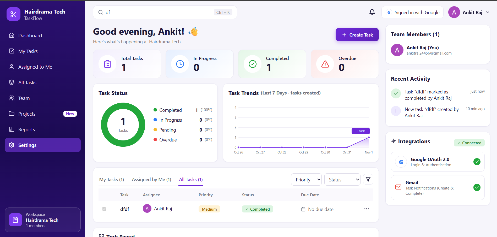
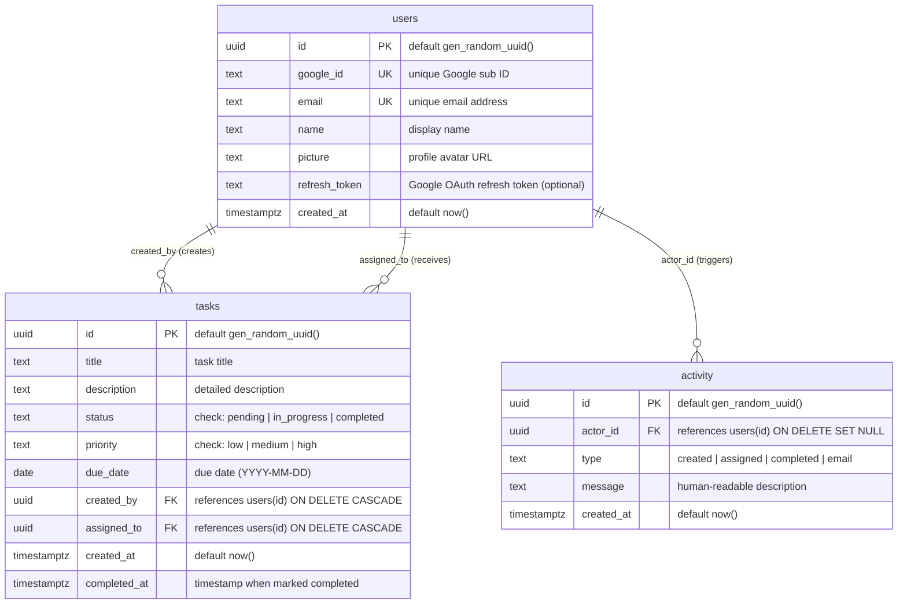
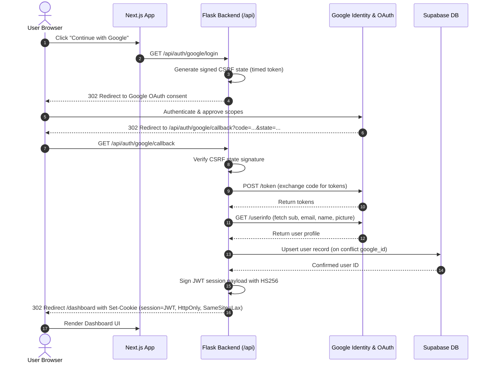
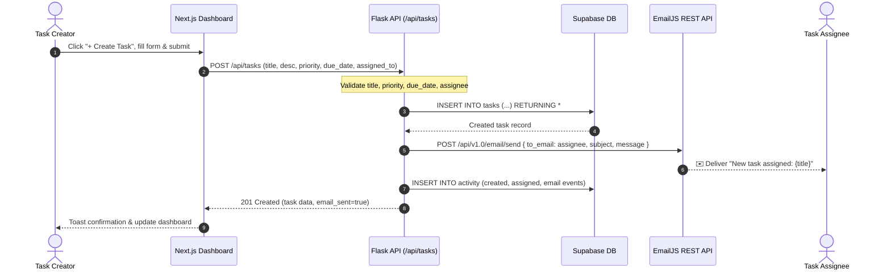
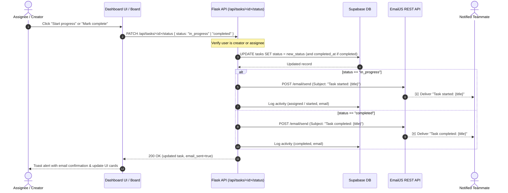

# TaskFlow – Task Manager (Hairdrama Tech assignment)

Create tasks, assign them to teammates, track progress on a real-time dashboard, and receive automated email notifications when tasks are created, started, and completed. Securely authenticated with Google OAuth 2.0.

🔗 **Live Deployment:** [https://hairdrama-taskmanager.vercel.app/](https://hairdrama-taskmanager.vercel.app/)

---

## 📸 Application Preview



---

## ⚡ Tech Stack

| Layer | Technology | Purpose |
|---|---|---|
| **Database** | Supabase (PostgreSQL) | Managed relational database with Row Level Security |
| **Backend** | Python / Flask | Serverless API hosted on Vercel (`api/index.py`), handling OAuth, data, & email dispatch |
| **Frontend** | Next.js 14 + TypeScript | App Router, React Server/Client Components, dynamic charts & dashboard |
| **Authentication** | Google OAuth 2.0 | Authorization code flow with signed CSRF state & HttpOnly JWT cookie |
| **Email Delivery** | EmailJS (REST API) | Automated email notifications for Task Created, Started (In Progress), & Completed |
| **Hosting** | Vercel (Unified) | Single unified project hosting both Next.js frontend and Python backend |

---

## 🏛 Architecture

```
                         one Vercel project / one domain
 ┌──────────────────────────────────────────────────────────────────────┐
 │  Next.js (app/, components/)          Flask (backend/) via api/index.py │
 │  ─────────────────────────            ───────────────────────────────── │
 │  /            login page              /api/auth/google/login  ─▶ Google │
 │  /dashboard   dashboard UI            /api/auth/google/callback ◀─ code │
 │       │                                  ├─ exchange code → tokens      │
 │       │  fetch("/api/...")               ├─ upsert user ───────▶ Supabase│
 │       └──(HttpOnly session cookie)──▶    └─ set JWT cookie              │
 │                                       /api/tasks, /api/users, ...       │
 │                                          ├─ read/write ────────▶ Supabase│
 │                                          └─ mailer ───────────▶ EmailJS │
 └──────────────────────────────────────────────────────────────────────┘
```

### Architectural Decisions
- **Unified Domain & Same-Origin Cookies:** `vercel.json` routes `/api/*` requests directly to Flask serverless functions. Eliminates CORS complexity and allows session tokens to live inside an **HttpOnly, Secure, SameSite=Lax cookie**, protecting users from XSS attacks.
- **Server-Side OAuth Protection:** Client secrets never reach the browser. Login state is verified using a cryptographic URL-safe timed signature (`URLSafeTimedSerializer`) expiring in 10 minutes to protect against CSRF attacks.
- **Dedicated JWT Session:** Google access tokens are only used for profile retrieval during sign-in; our application issues a signed 7-day HS256 JWT cookie for persistent sessions.
- **Server-Side EmailJS Dispatch:** Emails are triggered from the Flask backend using the EmailJS REST API (`POST https://api.emailjs.com/api/v1.0/email/send`) with the server's private `accessToken`. Client keys are never exposed in browser network payloads.
- **Zero Public Access Database:** Supabase Row Level Security (RLS) is enabled with no public policies. All database access is brokered through the Python backend via the `service_role` key.
- **Dynamically Derived Overdue State:** "Overdue" status is calculated at runtime by comparing the task's due date against the current date, guaranteeing real-time accuracy without stale flags.

---

## 🗄 Database & Table Schemas

The database schema is hosted on Supabase (PostgreSQL) and consists of three core relational tables: `users`, `tasks`, and `activity`.



### 1. `users` Table
Stores authenticated Google users and profile metadata.

| Column | Type | Constraints | Description |
|---|---|---|---|
| `id` | `uuid` | `PRIMARY KEY`, `DEFAULT gen_random_uuid()` | Unique user identifier |
| `google_id` | `text` | `NOT NULL`, `UNIQUE` | Google OpenID `sub` identifier |
| `email` | `text` | `NOT NULL`, `UNIQUE` | User's verified Google email address |
| `name` | `text` | `NOT NULL` | Display name from Google profile |
| `picture` | `text` | `NULLABLE` | URL of the user's avatar image |
| `refresh_token` | `text` | `NULLABLE` | Stored OAuth refresh token |
| `created_at` | `timestamptz` | `NOT NULL`, `DEFAULT now()` | User registration timestamp |

### 2. `tasks` Table
Stores all task details, assignments, status lifecycle, priority, and completion timestamp.

| Column | Type | Constraints | Description |
|---|---|---|---|
| `id` | `uuid` | `PRIMARY KEY`, `DEFAULT gen_random_uuid()` | Unique task identifier |
| `title` | `text` | `NOT NULL` | Task title / summary |
| `description` | `text` | `NULLABLE` | Optional detailed description |
| `status` | `text` | `NOT NULL`, `DEFAULT 'pending'`, `CHECK (status IN ('pending', 'in_progress', 'completed'))` | Current lifecycle state |
| `priority` | `text` | `NOT NULL`, `DEFAULT 'medium'`, `CHECK (priority IN ('low', 'medium', 'high'))` | Task priority level |
| `due_date` | `date` | `NULLABLE` | Task due date |
| `created_by` | `uuid` | `NOT NULL`, `REFERENCES users(id) ON DELETE CASCADE` | Creator of the task |
| `assigned_to` | `uuid` | `NOT NULL`, `REFERENCES users(id) ON DELETE CASCADE` | Assigned team member |
| `created_at` | `timestamptz` | `NOT NULL`, `DEFAULT now()` | Task creation timestamp |
| `completed_at` | `timestamptz` | `NULLABLE` | Timestamp when status transitioned to `completed` |

**Indexes & Foreign Keys:**
- `tasks_created_by_idx` on `tasks(created_by)`
- `tasks_assigned_to_idx` on `tasks(assigned_to)`
- Foreign keys cascade on delete to prevent orphaned tasks.

### 3. `activity` Table
Audit trail logging key events such as task creation, assignments, status changes, and automated emails sent.

| Column | Type | Constraints | Description |
|---|---|---|---|
| `id` | `uuid` | `PRIMARY KEY`, `DEFAULT gen_random_uuid()` | Unique activity event ID |
| `actor_id` | `uuid` | `NULLABLE`, `REFERENCES users(id) ON DELETE SET NULL` | User who performed the action |
| `type` | `text` | `NOT NULL` | Event category (`created`, `assigned`, `completed`, `email`) |
| `message` | `text` | `NOT NULL` | Human-readable activity message |
| `created_at` | `timestamptz` | `NOT NULL`, `DEFAULT now()` | Event timestamp |

**Indexes:**
- `activity_created_at_idx` on `activity(created_at DESC)` for efficient retrieval of recent events.

### Security and Row Level Security (RLS)
- Both `users`, `tasks`, and `activity` have Row Level Security enabled (`ALTER TABLE ... ENABLE ROW LEVEL SECURITY`).
- No public access policies are granted, ensuring that Supabase's public `anon` key cannot read or write data.
- All database operations are brokered securely via the Flask backend running in Vercel using the Supabase `service_role` key.

---

## 🔄 Application Workflows

### 1. Authentication & Session Workflow



---

### 2. Task Creation & Assignment Email Workflow
When a task is created, EmailJS sends an assignment notification to the assignee, and the activity feed is updated.



---

### 3. Task Status Lifecycle & Email Notifications (Started & Completed)
Status transitions across `pending` ➔ `in_progress` ➔ `completed`. EmailJS notifies the relevant party for **both** Started and Completed states:



---

### 4. Metrics & Trend Analytics Workflow
- **Stat Cards:** Real-time counters for **Total Tasks**, **In Progress**, **Completed**, and **Overdue**.
- **Derived Overdue Calculation:** Evaluated dynamically using `due_date < today && status != 'completed'`.
- **Status Donut Chart:** Visual breakdown with interactive percentages of task completion and pending bottlenecks.
- **7-Day Trend Chart:** Shows task creation activity across the last 7 calendar days.
- **Filter Tabs:** Toggle between `My Tasks` (assigned to you), `Assigned by Me` (created by you), and `All Tasks`.
- **Search & Filter:** Instant Ctrl+K quick search by title/description, plus dropdown filters for Priority and Status.

---

## 📂 Folder Structure

```
api/index.py        Vercel entrypoint (exports the Flask app)
backend/            Flask app, Supabase client, EmailJS mailer
app/, components/   Next.js pages and UI components
lib/                shared types, helpers, fetch wrapper
migrations/         SQL, run in order in the Supabase SQL editor
public/             dashboard preview screenshot
vercel.json         routes /api/* to the Flask function
launch.bat          one-click install + run on Windows
```

---

## 📧 EmailJS Setup Guide

TaskFlow sends notification emails via EmailJS REST API called from the Flask server. Follow these 3 steps to set it up:

1. **Email Services & Templates:**
   - In [emailjs.com](https://www.emailjs.com/), connect an email service (e.g. Gmail/Outlook) and copy the **Service ID**.
   - Create an Email Template with:
     - **To Email:** `{{to_email}}` *(Make sure this is set to `{{to_email}}` in template settings)*
     - **Subject:** `{{subject}}`
     - **Content:** `<div style="white-space:pre-line">{{message}}</div>` (preserves line breaks)
     - Copy the **Template ID**.
2. **Enable Server API Access (Crucial!):**
   - Go to **Account** -> **Security**.
   - Toggle **ON**: **"Allow EmailJS API for non-browser applications"**. *(If this is off, EmailJS will block server calls with an HTTP 403 error)*.
3. **Set Environment Variables:**
   - Set in `.env` locally and in Vercel project settings:
     ```env
     EMAILJS_SERVICE_ID=service_xxxxxxx
     EMAILJS_TEMPLATE_ID=template_xxxxxxx
     EMAILJS_PUBLIC_KEY=your_public_key
     EMAILJS_PRIVATE_KEY=your_private_key
     ```

---

## 🚀 Run locally (Windows)

1. **Supabase:** create a project, run `migrations/001_init.sql` then `migrations/002_dashboard.sql` in the SQL editor. Copy the Project URL and `service_role` key.
2. **Google Cloud Console:** create a project, then
   - OAuth consent screen: default email/profile scopes are enough. While the app is in *Testing* mode, add every account that will log in as a **test user**.
   - Credentials → OAuth client ID (Web). Authorized redirect URIs: `http://localhost:3000/api/auth/google/callback` and `https://YOUR-APP.vercel.app/api/auth/google/callback`.
3. Double-click **`launch.bat`**. First run creates `.env` and opens it; fill it in and run it again. It creates a virtualenv, installs pip and npm packages, checks the Supabase connection settings, then runs Flask (5000) and Next.js (3000) together in one window and opens http://localhost:3000. Press Ctrl+C to stop.

---

## 🌐 Deploy to Vercel (frontend + backend together)

1. Push the repo to GitHub, then **Add New → Project** in Vercel and import it.
2. Add the environment variables from `.env.example`, with `GOOGLE_REDIRECT_URI=https://YOUR-APP.vercel.app/api/auth/google/callback`.
3. Deploy, then add that redirect URI in Google Cloud.

---

## 🔌 API

| Method | Path | Purpose |
|---|---|---|
| GET | `/api/auth/google/login` | start OAuth |
| GET | `/api/auth/google/callback` | finish OAuth, set session cookie |
| POST | `/api/auth/logout` | clear the cookie |
| GET | `/api/me` | current user (+ whether EmailJS is configured) |
| GET | `/api/users` | team members |
| GET | `/api/tasks` | all tasks |
| POST | `/api/tasks` | create task, email assignee via EmailJS |
| PATCH | `/api/tasks/<id>/status` | change status; notifies teammate via EmailJS on start (`in_progress`) and completion (`completed`) |
| GET | `/api/activity` | recent activity feed |

---

## ⚖️ Known trade-offs
- Email is sent synchronously inside the request. A job queue would scale better for high volume.
- Sidebar items Projects, Reports and Settings are placeholders and show "Coming soon".
- The trend chart shows tasks created per day (no history table), not a cumulative total.
